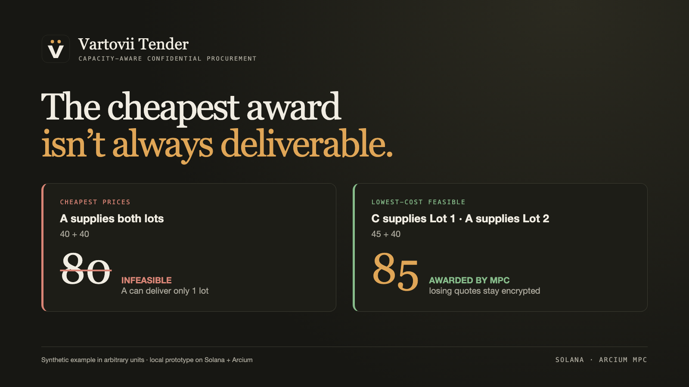
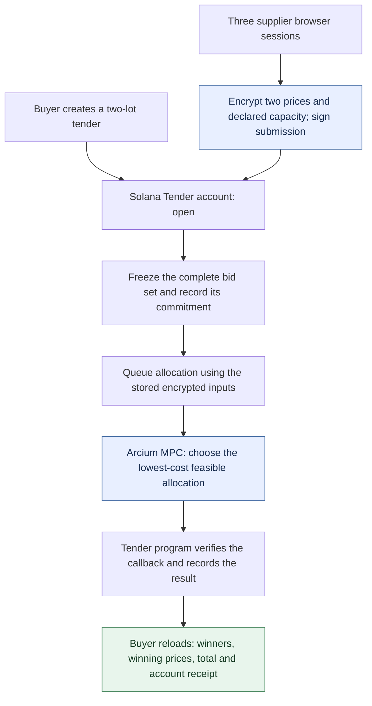

# Vartovii Tender

### A feasible procurement award from encrypted supplier bids.

**Solana · Arcium MPC · Capacity-aware allocation** · Built for Colosseum's Crypto World's Fair



| Watch | Link |
| --- | --- |
| Product demo (3 min) | DEMO_VIDEO_URL |
| Pitch (2 min) | PITCH_VIDEO_URL |

A buyer needs two lots fulfilled. The cheapest supplier can handle only one.
Vartovii Tender explores how to select a feasible award without requiring the
buyer to receive every supplier's losing quote.

**Current stage:** a local, synthetic prototype. One complete
browser → Arcium → verified callback → buyer reload flow has passed independent
local review. Public deployment and repeated-run reliability are not established.

[Try the local mock](experiments/arcium-procurement/demo/MOCK_REVIEW.md) ·
[Run the allocation tests](#review-in-a-few-minutes) ·
[Explore the source](#source-map) ·
[See the evidence boundaries](#what-is-established)

## Why this workflow matters

Procurement is often a constrained allocation problem: a buyer needs several
lots, while each supplier has limited capacity. Choosing the lowest price for
each lot independently can produce an award that cannot be fulfilled.

The buyer also has a commercial interest in the outcome. Once all quotes are
visible, they can be shared or reused in later negotiations—a form of
*bid shopping*. A server controlled by the buyer still requires suppliers to
trust that operator with their prices.

Tender's proposed value is **a feasible allocation with limited disclosure and
a traceable result chain**. A trusted procurement platform remains a credible
alternative; the prototype explores a different trust model. It does not claim
to eliminate collusion, dishonest capacity declarations, or price inference.

## How it works



The browser encrypts both prices and declared capacity before submission.
The frozen commitment covers tender terms and the stored bid set; queueing
uses those stored inputs. The buyer receipt shows the account address,
commitment, lifecycle state, result status and read time. Reload reads current
account state; it does not independently recheck callback transaction history.

## The example: why 85 beats 80

These are **public synthetic teaching inputs**, in arbitrary price units.
Publishing this fixture is separate from the intended disclosure policy of a
real tender.

| Supplier | Lot 1 quote | Lot 2 quote | Declared capacity |
| --- | ---: | ---: | ---: |
| A | 40 | 40 | 1 lot |
| B | 55 | 50 | 2 lots |
| C | 45 | 60 | 1 lot |

| Candidate award | Total | Feasible? |
| --- | ---: | --- |
| A supplies both lots | 80 | No: exceeds A's capacity |
| **C supplies Lot 1; A supplies Lot 2** | **85** | **Yes: lowest-cost feasible award** |

The current circuit is bounded to **three suppliers and two lots**. The
independent oracle enumerates all nine assignments. Larger tender sizes and
their MPC performance have not been measured.

## What becomes visible

| Surface | Data |
| --- | --- |
| Supplier's own browser | Its own entered prices and capacity; local signing and encryption identity |
| Tender account before award | Tender metadata, supplier identities, encrypted bid fields, encryption public keys and nonces; frozen commitment once set |
| Finalized successful award | Winning supplier slots, winning prices, total and result status |
| Losing prices and declared capacities | Submitted as encrypted inputs; not included as plaintext in the bounded award output |

**Winning prices are disclosed.** Limiting disclosure of losing quotes is the
design objective, not a completed privacy audit. Browser storage, logs,
metadata, inference from outputs and the MPC trust assumptions still require
assessment before real use.

## Review in a few minutes

### 1. Check the allocation and integrity models

From the repository root, with Node.js 24 or later:

```sh
node --test experiments/arcium-procurement/oracle.test.mjs experiments/arcium-procurement/b2-integrity.test.mjs
```

These dependency-free model tests cover feasible allocation, deterministic
ties, invalid inputs, no-feasible outcomes and modeled integrity checks.
They do not execute the Solana program or Arcium.

### 2. Inspect the buyer experience

Follow the [isolated mock setup](experiments/arcium-procurement/demo/MOCK_REVIEW.md)
to install and build a disposable demo copy, then serve it on `127.0.0.1`.
Every page is marked **MOCK ONLY · SYNTHETIC**.

The committed reviewer guide covers four read-only views: successful award at
85, pending computation, finalized nonzero status with no award, and account
read failure. This path uses static fixtures, has no mutation endpoints and
does not connect to Solana or Arcium.

The mock also serves a read-only supplier session page (`/supplier?slot=0`)
that generates a browser identity and shows the encrypted-bid form; submitting
from the mock is intentionally not supported.

The mock is a UI review aid. It does not replay the separately accepted B3 run.
Do not use the normal `dev` server as a fresh-clone review command: its live
adapter needs generated IDL and circuit files that are excluded from this
source package. A clean dependency install remains an unverified release gate.

## What is established

Evidence summary as of **September 29, 2026**. Model checks, mock UI checks and
encrypted local execution establish different things.

| Area | Accepted evidence | Remaining boundary |
| --- | --- | --- |
| Allocation model | Local tests cover the bounded optimizer and edge cases | No larger-scale performance result |
| Encrypted allocation, B1 | Four local synthetic encrypted fixtures matched an independent oracle | No public-chain or production execution claim |
| Browser flow, B3 | **PASS for one isolated synthetic local flow:** buyer creation, three supplier bids, freeze, queue, exact successful callback binding and final buyer reload at 85 | Repeatability, deployment and exact loaded-binary readback are unverified |
| Integrity, B2 | **PARTIAL:** signed submissions, frozen-input binding and several local adversarial checks | Genuine wrong-context callback delivery and authentic MPC-failure provenance remain unproved; build is on hold after a host toolchain permission denial |
| Buyer reviewer path | Local synthetic mock views and receipt presentation reviewed | No fresh live failure or privacy assurance follows |

The accepted B3 review checked a 68-entry evidence manifest, the callback
transaction's successful execution and exact Tender/computation bindings,
decoded results against the independent oracle, and the final buyer reload.
That retained local evidence bundle is separate from this authored source
package; it is not reproduced by the commands above.

No production security assessment, verified supplier capacity, customer usage
or demand evidence is established. Payment and settlement are outside the
prototype.

## Source map

| Component | Start here |
| --- | --- |
| Independent allocation oracle | [oracle.mjs](experiments/arcium-procurement/oracle.mjs) |
| Executable integrity model | [b2-integrity.mjs](experiments/arcium-procurement/b2-integrity.mjs) |
| Solana Tender lifecycle and callback | [programs/tender/src/lib.rs](experiments/arcium-procurement/b2/programs/tender/src/lib.rs) |
| Encrypted allocation circuit | [encrypted-ixs/src/lib.rs](experiments/arcium-procurement/b2/encrypted-ixs/src/lib.rs) |
| Browser encryption and buyer UI | [client.js](experiments/arcium-procurement/demo/src/client.js) |
| Signed bid protocol | [protocol.mjs](experiments/arcium-procurement/demo/src/protocol.mjs) |
| Local synthetic reviewer server | [mock-server.mjs](experiments/arcium-procurement/demo/mock-server.mjs) |
| B2 setup constraints | [REPRODUCIBILITY.md](experiments/arcium-procurement/b2/REPRODUCIBILITY.md) |

The historical B2 wallet configuration is not portable. Keys, generated
artifacts, dependency trees and raw runtime data are excluded from the source
package.

## Next development gates

1. **Repeatable prototype:** fresh runs, measured timing, failure-state UX and
   checks across actual disclosure surfaces; resolve or explicitly retain the
   B2 integrity limits.
2. **Supplier inclusion receipt, conditional:** show that a supplier's signed
   submission belongs to the frozen input set bound to the computation.
   This is planned, not an implemented proof of MPC correctness.
3. **External evaluation:** a clearly labeled accessible demo, then a shadow
   pilot with a real procurement workflow. Deployment alone does not validate
   customer demand.
4. **Commercial product:** security assessment, broader allocation requirements
   and operational integrations, gated by pilot feedback and paid repeat use.

## Attribution and licensing

See [upstream attribution](experiments/arcium-procurement/ATTRIBUTION.md) for
the public Arcium example used as a reference. No repository-wide public
license has been selected yet.
